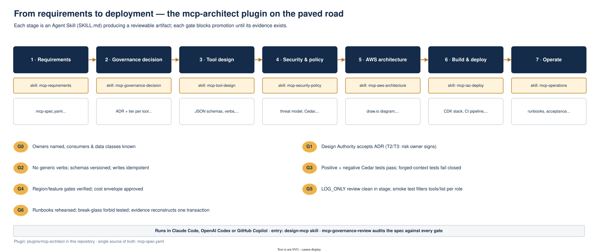
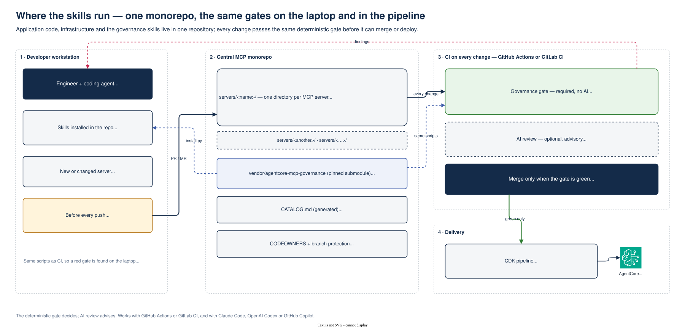

# AgentCore MCP Governance

**Govern MCP servers on AWS with Amazon Bedrock AgentCore Gateway, from requirements to production.**

Agents need tools, and MCP is how tools get exposed. Without a deliberate stance an organisation ends up with dozens of MCP servers, each with its own idea of identity, tenant isolation and approval. This repository packages a governance method and a paved road for that problem:

- a **decision framework**: five questions that decide whether something should be MCP at all, which control plane governs it (AgentCore Gateway, a self-managed gateway, direct MCP or app endpoints), which controls each tool needs (risk tiers T0–T3), how strongly partitions are isolated, and whether to build, wrap or reuse the server;
- **Cedar policy patterns** for AgentCore Policy: default deny, one permit per tool, partition conditions, argument limits, break-glass forbids, LOG_ONLY shadowing;
- a **CDK reference stack**: Gateway with CUSTOM_JWT, policy engine, REQUEST interceptor for trusted context, idempotent Lambda adapter with bound approvals, and a CI pipeline from LOG_ONLY to ENFORCE;
- **`mcp-architect`**, a skill pack that walks a team through all of it, in Claude Code, OpenAI Codex or GitHub Copilot.

Background: the article [Governing MCP in the Enterprise](https://karim-boudich.com/posts/governing-mcp-in-the-enterprise/), the whitepaper [Governed Agent Tooling on AWS](https://karim-boudich.com/whitepapers/governed-agent-tooling-on-aws/) and the [AgentCore Gateway series](https://karim-boudich.com/series/agentcore-gateway/).



The pack is ten [Agent Skills](https://agentskills.io) (`SKILL.md`) plus tested Python scripts. The rules that must not drift live in the scripts, not in any agent's prompt.

## Central MCP monorepo

The method works best with one repository that holds every MCP server in the organisation: the application code, its infrastructure, and the skills themselves. It gives the platform team and the Design Authority one place to see what exists, and the same gates run on every developer's machine and in GitHub Actions on every change.



```
your-mcp-platform/
  servers/<name>/           one directory per MCP server, whatever system it fronts
    mcp-spec.yaml           owners, consumers, systems, tools, tiers
    adr-0001-<name>.md      governance decision
    infra/                  CDK stack, hardened Cedar policies, adapter, tests
  CATALOG.md                generated: every server and tool, owners, tiers, check status
  CODEOWNERS                domain team per server, platform team for governance files
  vendor/agentcore-mcp-governance/   this repository, pinned as a submodule
  .github/workflows/mcp-governance.yml
```

Set it up in an empty repository:

```bash
git submodule add https://github.com/KBoudich/agentcore-mcp-governance vendor/agentcore-mcp-governance
python3 vendor/agentcore-mcp-governance/scripts/install.py . --agents codex,copilot,claude \
  --plugin-path vendor/agentcore-mcp-governance --monorepo
```

On every pull request and push to `main`:

- **`checks` (the gate, no AI):** `scripts/check_repo.py` checks each changed server:
  - the spec rules (tiers, identity inputs, idempotency, approvals, Regions);
  - that a governance ADR exists;
  - one permit and one break-glass forbid per tool;
  - no permit for an unknown tool, and no permit that covers every action;
  - unique server names;
  - that `CATALOG.md` is current.

  Missing artefacts are warnings while a server is `draft` and errors from `pilot` on. Make it a required status check.
- **`ai-review` (advisory):** set the repository variable `MCP_AI_REVIEWER` to `claude` or `codex` to have that agent run the `mcp-governance-review` skill on the changed servers and comment on the pull request. For GitHub Copilot code review, enable it with a ruleset; it reads `.github/copilot-instructions.md`.

Engineers get the same checks locally through the `mcp-repo-compliance` skill, before they push.

## Install

**Codex, GitHub Copilot (and other Agent Skills clients)** — vendor it into the repository where the MCP server will live:

```bash
git clone https://github.com/KBoudich/agentcore-mcp-governance
python3 agentcore-mcp-governance/scripts/install.py <your-repo>                          # codex,copilot → .agents/skills/
python3 agentcore-mcp-governance/scripts/install.py <your-repo> --agents codex,copilot,claude
```

This copies the plugin to `<your-repo>/tools/mcp-architect/` and each skill to `.agents/skills/<skill>/` (read by Codex and Copilot) and, with `claude`, to `.claude/skills/<skill>/`. Script paths in the copied skills point at `tools/mcp-architect/scripts/`, which is also where the generated CI pipeline expects them. Then ask your agent to "design an MCP server for <system>" or name the `design-mcp` skill.

**Claude Code** — install as a plugin to also get the `/mcp-architect:design-mcp` command and the `mcp-governance-reviewer` subagent (thin wrappers around the `design-mcp` and `mcp-governance-review` skills):

```bash
/plugin marketplace add KBoudich/agentcore-mcp-governance      # or a local path to this repo
/plugin install mcp-architect@agentcore-mcp-governance
```

## What's inside

| Stage | Skill | Produces | Gate |
| --- | --- | --- | --- |
| 1 | `mcp-requirements` | `mcp-spec.yaml` (single source of truth) | G0 owners, consumers, data classes |
| 2 | `mcp-governance-decision` | ADR: MCP or not, control plane, tiers, partition model, build/wrap/reuse | G1 Design Authority + risk owner |
| 3 | `mcp-tool-design` | bounded verbs, schemas, idempotency, approvals | G2 no generic verbs, writes idempotent |
| 4 | `mcp-security-policy` | threat model, Cedar permits + break-glass forbids, decision matrix | G3 positive/negative + forged-context tests |
| 5 | `mcp-aws-architecture` | draw.io diagram (AWS icons) + SVG, cost and quota envelope | G4 Region, connectivity, cost |
| 6 | `mcp-iac-deploy` | CDK project (Gateway, Policy, interceptor, adapter) + GitHub Actions | G5 LOG_ONLY review, smoke test |
| 7 | `mcp-operations` | runbooks, acceptance tests, go-live checklist | G6 drills, evidence reconstruction |

Plus `design-mcp`, which runs stages 1–7 in order with their gates; `mcp-repo-compliance`, which runs the repository checks before a commit and keeps the catalogue current; and `mcp-governance-review`, an independent GO / CONDITIONAL / NO-GO review. Run the review in a separate context (a Claude Code subagent or a fresh Codex/Copilot session) so the author does not grade their own design.

### Scripts (`scripts/`, Python 3.10+, PyYAML for YAML specs)

| Script | Purpose |
| --- | --- |
| `validate_spec.py` | governance rules: tier ↔ side effect, generic verbs, identity-in-arguments, idempotency, approvals, target/private-reach constraints, Region without Policy, quotas |
| `decide.py` | decision framework → ADR Markdown (or `--json`) |
| `cost_model.py` | gateway-layer monthly cost at several scales + search-quota warning |
| `gen_architecture.py` | spec → editable `.drawio` AWS architecture |
| `drawio_kit.py` | tiny builder for native draw.io files with verified `mxgraph.aws4` icons |
| `export_drawio.sh` | `.drawio` → `.svg` (draw.io desktop CLI, headless with `xvfb-run`) |
| `scaffold_deploy.py` | spec → CDK project, tool schemas, Cedar policies, decision matrix |
| `check_repo.py` | monorepo gate: checks every changed server, builds `CATALOG.md`, fails CI on governance errors |
| `install.py` | vendor the plugin and its skills into a repository for Codex, Copilot and/or Claude Code |

`reference/agentcore-facts.json` holds AgentCore prices, quotas and Region coverage with their verification date (2026-10-21). Re-verify before budgeting.

## Worked example

`examples/industrial-quality-certificates/` — a fictional manufacturer's Quality-domain server with T1 reads, a T2 draft and a T3 approval-bound action: spec, generated ADR, cost model, architecture diagram, Cedar policies and decision matrix. The CDK project generated from it type-checks and synthesises against `aws-cdk-lib` 2.274.0.

## Tests

```bash
python3 -m unittest discover -s tests
```

## Principles the plugin enforces

- Gateway solves reachability and enforcement; shape, isolation, approvals and correctness stay with the domain.
- Identity and partition come only from validated token context — never from model-controlled arguments.
- Default deny; one permit per tool; forbid wins; prod engine always ENFORCE, changes shadowed per policy.
- Rate limits are consumption control and fail open — never isolation.
- Every write is idempotent; every consequential action is a proposal bound to an approval.
- Facts about AWS behaviour are labelled as verified (with source/date) or as gates to verify.

## Diagrams

`docs/diagrams/` holds the reference diagrams as editable draw.io files with SVG exports: AWS reference architecture, trust path, operating model, decision framework, lifecycle and rollout roadmap.

## Licence and affiliation

MIT — see [LICENSE](LICENSE). This is personal work by Karim Boudich. It is not affiliated with, endorsed by, or describing the systems of any employer or AWS. Examples, organisation names, system names and volumes are illustrative.
